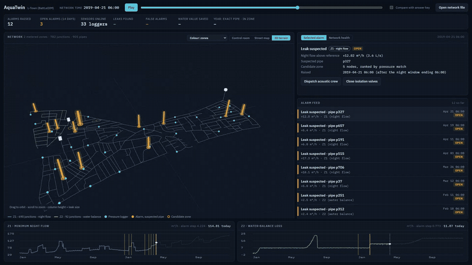
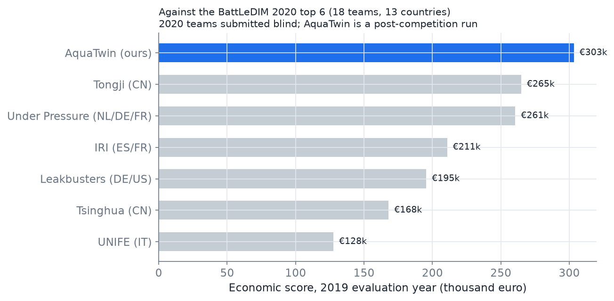
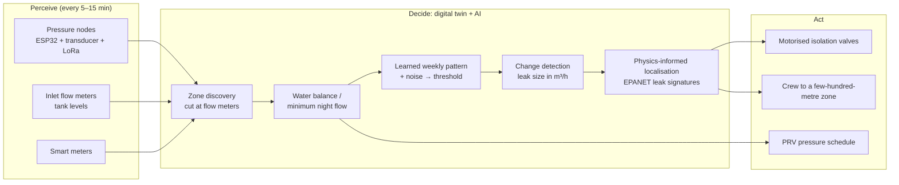
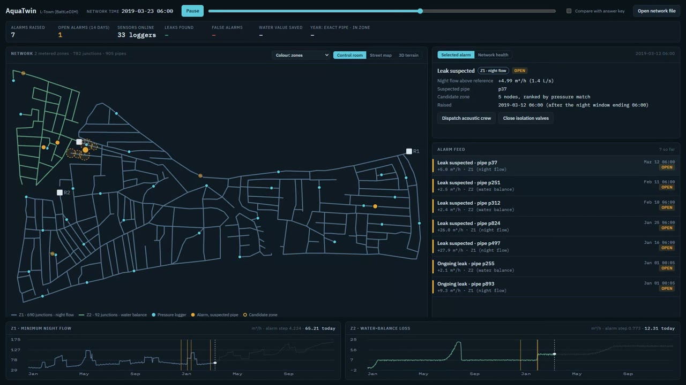
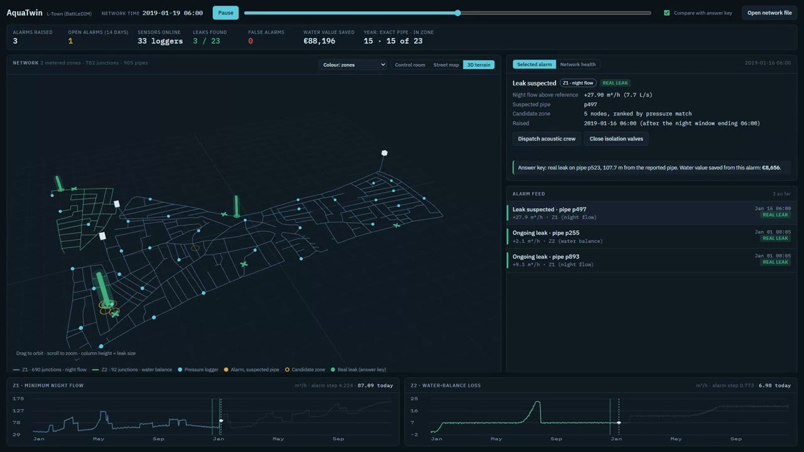
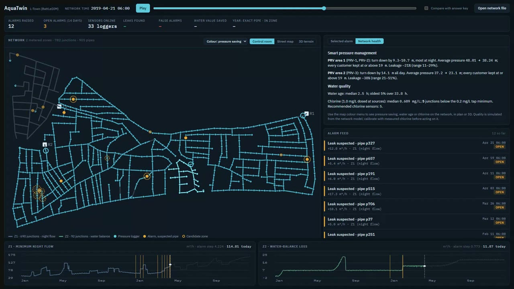
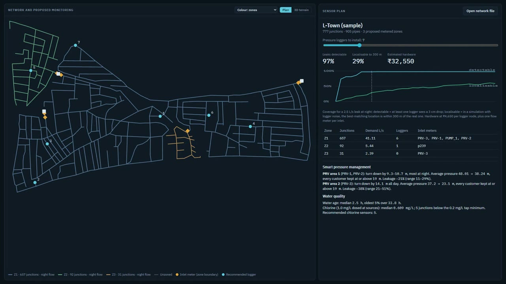
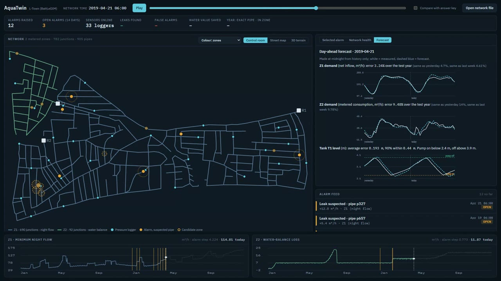
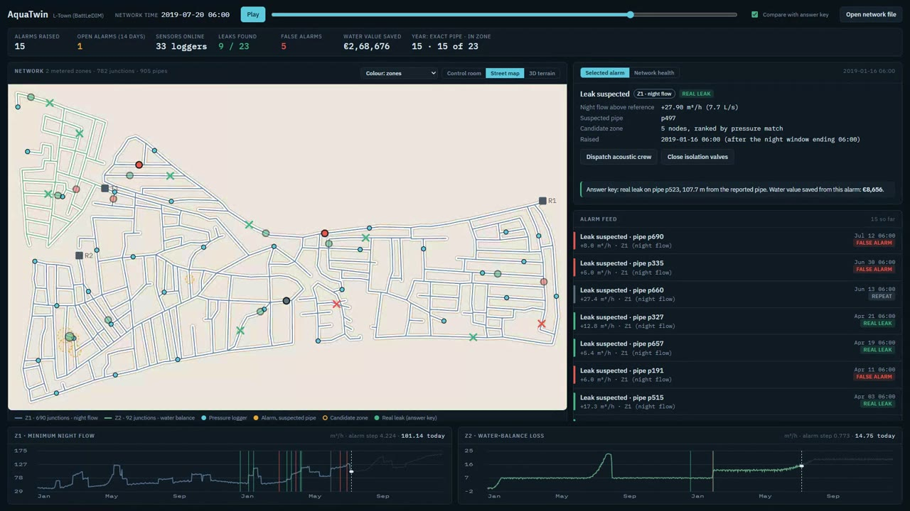

<div align="center">

# AquaTwin

**Physical AI that finds water leaks in city pipe networks and shuts them off.**

Sensors in the pipes → a hydraulic digital twin → AI that detects, sizes and locates the leak → valves that isolate it.

[](https://www.python.org/)
[](https://github.com/USEPA/WNTR)
[](https://doi.org/10.5281/zenodo.4017659)
[](LICENSE)
[](#team)



*The AquaTwin control room replaying 2019 on L-Town. Each column rises from the pipe the AI suspects; its height is the leak size.*

</div>

---

## Why

Indian cities lose a large share of the water they treat before it reaches anyone, mostly through
leaks in buried pipes. Bursts are found when a road floods; slow leaks run for weeks. Utilities abroad
use AI and sensor networks to catch them early (Thames Water, Valencia's digital twin, DC Water), but
those systems are proprietary and priced for large Western utilities.

AquaTwin is an open, low-cost version of the same idea, built to run on any utility's EPANET network
file, with ESP32 + LoRa field hardware at about ₹4,650 a node.

## Results at a glance

<table>
<tr>
<td width="55%">

**BattLeDIM 2020 (L-Town, Cyprus)**, the international leak-detection benchmark run by KIOS (University of Cyprus) with TU Delft, Technion and Tsinghua. Scored with a Python port of the official algorithm that reproduces the official perfect score exactly.

| | Leaks found | False alarms | Economic score |
|---|---|---|---|
| **AquaTwin (4σ)** | **15 / 23** | **6** | **€303,324** |
| 2020 joint winners | 56–65 % | 3–4 | €260–265k |

The 2020 teams submitted blind; the 2019 answer key is now public, and the 4σ setting was chosen after seeing 2019 results ([disclosed here](battledim/METHOD_NOTES.md)). The setting chosen on 2018 alone (2.5σ) finds 18 / 23 with 13 false alarms (€343,806). Fair reading: competitive with the best published methods.

</td>
<td width="45%">

</td>
</tr>
</table>

| | Result | How it was measured |
|---|---|---|
| **Works on a network it never saw** | 15 / 23 on L-Town with no tuning; 4 of 5 bursts flagged in the right district on EPANET Net3 | Self-configuring engine, default settings |
| **Planner predicts the field** | rated L-Town's 33 sensors at 64 % localisable, they achieved 65 % | Planner run on the network file alone |
| **Smart pressure management** | 111,947 m³ saved on the real 2019 leaks (17 % of all leaked water); every customer kept ≥ 19 m | Hour-by-hour PRV schedule, FAVAD N1 = 1.0 (range 9–24 %) |
| **Day-ahead demand forecast** | 3.2 % error in district A vs 4.6 % for the best simple rule; tank T1 level within 0.19 m on average | Trained on 2018, scored on all of 2019 |
| **Water quality** | 5 junctions below the 0.2 mg/L chlorine minimum; 5 sensor sites recommended | EPANET quality engine (simulated only) |
| **Valve isolation** | closing the valves on the right node stopped the leak flow in 100 % of tests; 77 % less water lost than waiting for a report | 2,000-leak simulation on Net3 |

## How it works



1. **Self-configuring water balance.** The network is cut at every flow meter into metered districts (DMAs). Each gets an exact water balance (inflow − tank storage − smart-meter use) or its minimum night flow.
2. **Learned normal behaviour.** The weekly demand pattern and day-to-day noise are learned from the data, so every city gets its own thresholds with no hand tuning.
3. **Change detection.** A sustained rise is a new leak, sized in m³/h; a drop is a repair.
4. **Physics-informed localisation.** The night pressure change at every sensor is matched against leak signatures the EPANET twin computes for every junction. The flow rise fixes the size; the pressure pattern fixes the place. Matching pursuit separates simultaneous leaks.
5. **Act.** Close the valves around the suspected pipe, or send an acoustic crew to the candidate zone. The same twin schedules pressure-reducing valves, tracks chlorine, and forecasts tomorrow's demand and tank levels.

## Screenshots

| Control room (2D) | Answer key overlay (3D) |
|---|---|
|  |  |
| **Smart pressure management** | **Sensor planner** |
|  |  |
| **Day-ahead forecast** | **Street-map view** |
|  |  |

## Quick start

Python 3.12 on Windows, macOS or Linux.

```bash
git clone https://github.com/nmiheer715-hue/AquaTwin.git
cd AquaTwin
python -m venv .venv
.venv/Scripts/pip install -r requirements.txt     # macOS/Linux: .venv/bin/pip install -r requirements.txt
```

**Try it on the sample city (EPANET Net3, simulated SCADA included):**

```bash
.venv/Scripts/python -m aquatwin.run examples/net3/net3.json --truth examples/net3/truth.csv
# then open examples/net3/out/dashboard.html
```

**Use it on your own network:** start the local app and upload an EPANET `.inp` file (and SCADA CSVs if you have them).

```bash
.venv/Scripts/python -m aquatwin.app    # then open http://127.0.0.1:8050
```

- **Plan sensors** (network file only): proposed district boundaries, extra meters where zones are too big, ranked logger locations with cost and a coverage curve, plus pressure-management and water-quality checks.
- **Monitor leaks** (network + SCADA): zones and thresholds set up automatically, daily alarms with district, size and suspected pipe, the control room with 2D / 3D / street views, replay, network health and forecasts.

Data format and what to expect: [ONBOARDING.md](ONBOARDING.md).

## Reproduce the BattLeDIM result

Download the BattLeDIM dataset from [Zenodo 4017659](https://doi.org/10.5281/zenodo.4017659) into `battledim/raw/`, then:

```bash
cd battledim
../.venv/Scripts/python load.py          # cache the SCADA CSVs
../.venv/Scripts/python sensitivity.py   # leak signature of every node from the L-Town twin (~1 min)
../.venv/Scripts/python submit.py        # run 2018–2019 day by day, write the submission, score it
../.venv/Scripts/python figures.py       # map, 2019 signals, leaderboard chart
```

Or run the generic engine on L-Town with the whole control room: `python -m aquatwin.run examples/ltown.json --truth battledim/truth_2019.csv`.

<details>
<summary><b>What each file does</b></summary>

**`aquatwin/`: the generic engine and apps**

| File | Purpose |
|---|---|
| `run.py` | Runs a city from a config: zones, detection, localisation, evaluation, health, forecasts, dashboard |
| `network.py` · `data.py` | Zone discovery at flow meters; SCADA loading, water balance, weekly correction, noise |
| `signatures.py` · `engine.py` | Twin leak signatures; detection and localisation |
| `plan.py` | Sensor planner: DMA proposal, greedy logger placement scored by simulated localisation |
| `pressure.py` · `quality.py` | PRV schedule (CPHEEO 17 m + margin, FAVAD savings); water age and chlorine (BIS 10500) |
| `forecast.py` | Day-ahead demand per zone (gradient boosting) and tank-level roll-forward |
| `ui.py` · `templates/` | Self-contained control-room and planner pages (three.js 3D terrain, in-browser `.inp` reader) |
| `app.py` · `worker.py` | Local Flask app for uploading a city's network |

**`battledim/`: benchmark pipeline**

| File | Purpose |
|---|---|
| `network.py` | Districts and the official pipe-distance rule |
| `signals.py` | Minimum night flow (A+B) and smart-meter water balance (C) |
| `sensitivity.py` | Twin leak signatures at 03:00 for all 769 nodes |
| `detect.py` | Causal day-by-day detection, repair tracking, localisation |
| `scoring.py` | Python port of the official KIOS scoring algorithm |
| `submit.py` · `sweep.py` | Writes the submission and score; settings selection on 2018 only |
| `METHOD_NOTES.md` | Every design choice, including those made after seeing 2019 |

**Top level: controlled Net3 study**

| File | Purpose |
|---|---|
| `twin.py` · `generate.py` | Network model, demand variation, leak model; 2,000-leak simulated dataset |
| `train.py` · `isolate.py` · `figures.py` | Detection, placement and localisation; valve isolation and water saved; charts |

**Docs:** [CONCEPT_NOTE.md](CONCEPT_NOTE.md) · [HARDWARE.md](HARDWARE.md) (field node, bill of materials, path to deployment) · [ONBOARDING.md](ONBOARDING.md) · [VIDEO_SCRIPT.md](VIDEO_SCRIPT.md)

</details>

## Path to hardware

| Stage | What |
|---|---|
| **Field node** | ESP32 + 0–10 bar transducer + ADS1115 + LoRa SX1276, Li-SOCl₂ cell: about ₹4,650, 2+ years on battery. Our two-board ESP32 + RA-02 LoRa link with packet resend is built and tested. |
| **Valve node** | ESP32 + relay + motorised ball valve with limit-switch feedback, or a PRV pilot actuator for pressure schedules |
| **Prototype** | Tabletop pipe loop with pressure nodes, a flow sensor, solenoid "bursts" and a motorised valve, running this code live against an EPANET model of the loop |
| **Pilot** | One DMA modelled from GIS, 8–12 nodes at the planner's locations, four weeks in shadow mode, then live alarms and valve control |

Details in [HARDWARE.md](HARDWARE.md).

## Limits, stated honestly

- The BattLeDIM 4σ setting was picked after seeing 2019 results; the blind-comparable setting is 2.5σ (18 / 23, 13 false alarms).
- Pressure management, water quality and the Net3 study are simulation results. BattLeDIM has no measured quality data.
- Real networks have larger model errors than our simulated ±5 % demand noise, so field calibration is the first step of any pilot.
- Isolation assumes a motorised valve on each pipe around a node; real networks isolate segments between existing valves.

## Credits

- **BattLeDIM 2020** dataset and the official scoring algorithm (in `battledim/scoring/`) by the KIOS Research and Innovation Center of Excellence, University of Cyprus, and partners: [Zenodo 4017659](https://doi.org/10.5281/zenodo.4017659), [KIOS-Research/BattLeDIM](https://github.com/KIOS-Research/BattLeDIM). Their files remain under their original terms.
- **EPANET** (US EPA) and **WNTR** (Sandia National Laboratories / US EPA) for hydraulic and water-quality simulation.
- **three.js** for the 3D terrain view.

## Team

**Team Green Byte**: Miheer Nikam · Nihaal R
i-Hack 2026 (E-Summit, IIT Bombay) · TIH Physical AI Hackathon · Track 4: AI in Water Management

## License

[MIT](LICENSE) for AquaTwin's own code and docs. Third-party data and code keep their own licences (see Credits).
